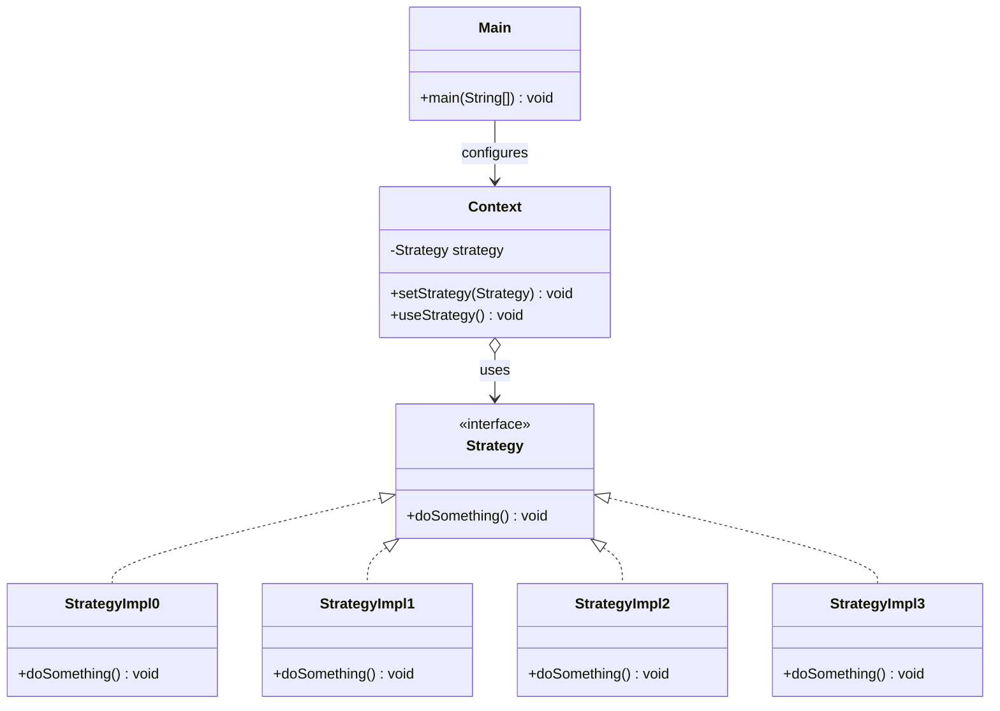
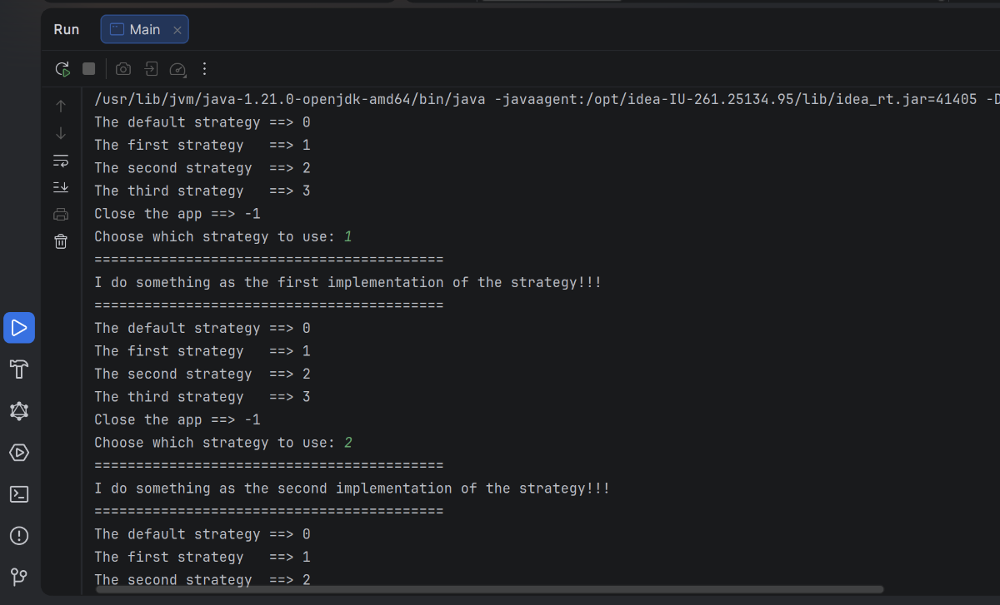

# TP1 — Strategy Design Pattern

A small Java console app that demonstrates the **Strategy** design pattern: the user picks a behavior at runtime, and the app swaps it in without changing any other code.

## What is the Strategy pattern?

It lets you define a **family of interchangeable behaviors**, put each one in its own class, and switch between them at runtime.

- **Strategy**: the common interface every behavior follows.
- **Concrete strategies**: the actual behaviors (`StrategyImpl0` … `StrategyImpl3`).
- **Context**: the class that *uses* a strategy, without knowing which one it is.

**Use case:** a payment page where the user picks *Card*, *PayPal* or *Cash*. Each payment method is a strategy; the checkout (context) just calls `pay()`.

## Class diagram



## Project structure

```
tp1-pattern-strategy/
├── pom.xml
└── src/main/java/
    ├── Strategy.java        # Strategy interface
    ├── StrategyImpl0.java   # Default strategy
    ├── StrategyImpl1.java   # First strategy
    ├── StrategyImpl2.java   # Second strategy
    ├── StrategyImpl3.java   # Third strategy
    ├── Context.java         # Holds and runs the current strategy
    └── Main.java            # Interactive menu
```

## How it works

| Class | Role |
|---|---|
| `Strategy` | Interface with one method: `doSomething()` |
| `StrategyImpl0..3` | Each prints its own message in `doSomething()` |
| `Context` | Starts with `StrategyImpl0` by default; `setStrategy()` swaps it, `useStrategy()` runs it |
| `Main` | Shows a menu, reads a number, creates the matching strategy, and runs it |

### Loading the strategy with reflection

`Main` does not use a `switch` to create the strategy. It builds the class name from the user's choice:

```java
Strategy strategy = (Strategy) Class.forName("StrategyImpl" + n)
        .getConstructor()   // the no-arg constructor
        .newInstance();     // create the object
```

- `Class.forName("StrategyImpl2")` finds the class by its name.
- `getConstructor()` gets its no-arg constructor.
- `newInstance()` creates an object from it.

**Benefit:** adding a `StrategyImpl4` only needs a new class (and a menu line), with no `switch` to edit.

## Run it

Requires **Java 21** and **Maven**.

```bash
mvn compile
java -cp target/classes Main
```

## Example session


```
The default strategy ==> 0
The first strategy   ==> 1
The second strategy  ==> 2
The third strategy   ==> 3
Close the app ==> -1
Choose which strategy to use: 3
==========================================
I do something as the third implementation of the strategy!!!
==========================================
```

Enter `-1` (or any number outside `0–3`) to quit.